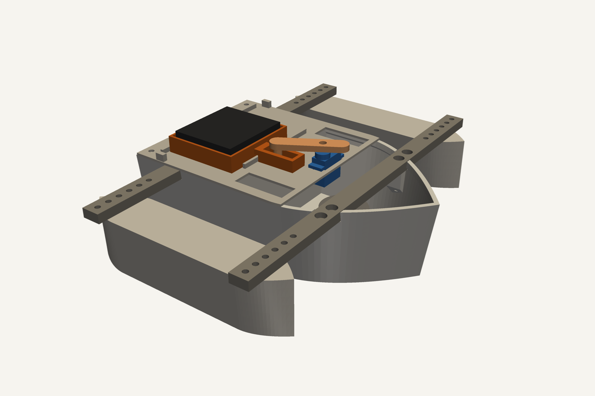
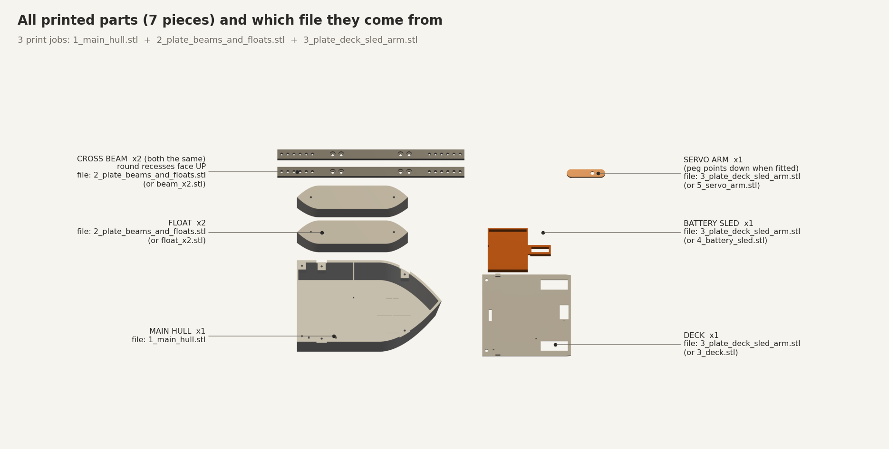
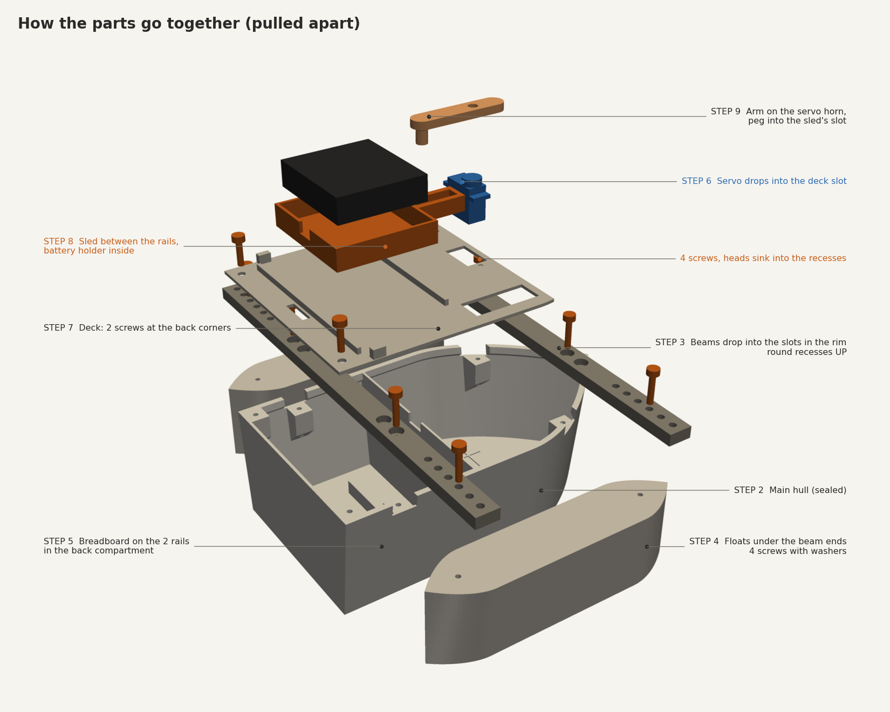
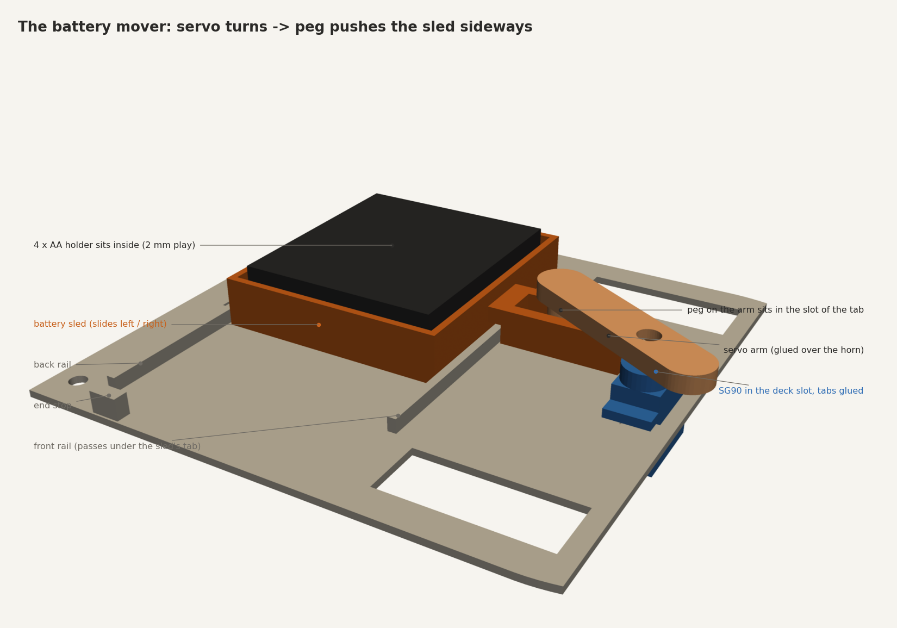
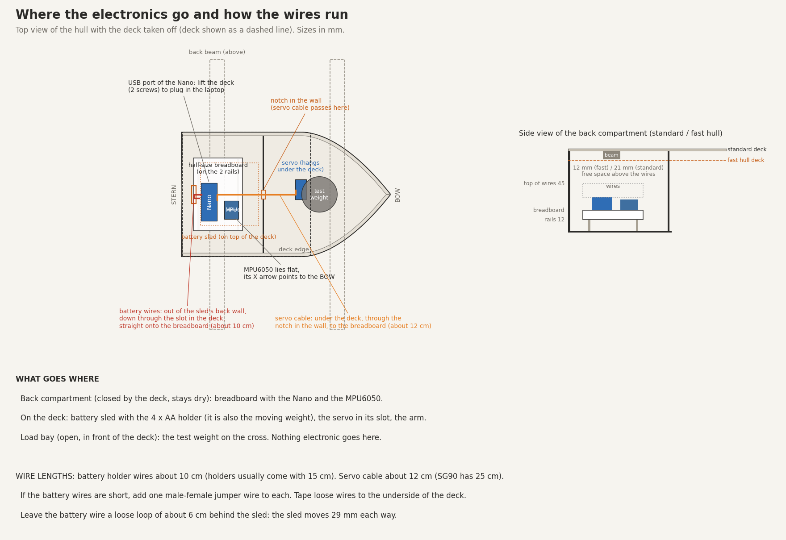
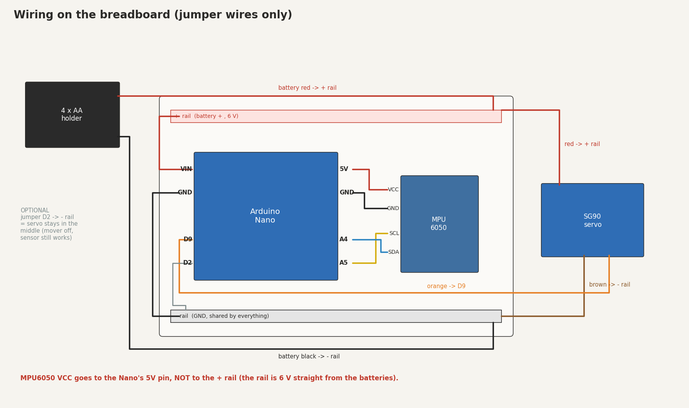

# Ballast-free trimaran: build guide

A small three-hull boat that stays upright without water tanks.
- **Wide side floats:** these keep it steady by themselves.
- **Sliding battery (extra):** an Arduino and a tilt sensor slide the battery pack towards the high side when the boat leans.

This guide covers everything from "the prints are ready" to "it floats in the tank". The steps are the same for the standard hull and the fast hull.



### In one minute: what the servo and the arm do

The servo's only job is to slide the battery pack left or right. The arm is how it pushes.

Think of a door handle: you turn the handle and it pushes the latch sideways.

- **The servo** is a tiny motor. When the Arduino tells it to, it turns a little to the left or a little to the right.
- **The arm** is a printed stick fixed to the top of the servo, so when the servo turns, the stick swings.
- **The tray with the batteries** sits next to it. The end of the stick is hooked into the tray (a peg in a slot).

**servo turns -> stick swings -> stick pushes the tray -> batteries slide sideways**

**Why slide the batteries?** Think of a seesaw: if one side goes down, you move a weight to the other side and it comes back level.
- The boat tips to the right.
- The sensor notices and tells the Arduino.
- The Arduino turns the servo, and the stick pushes the batteries to the left.
- The extra weight on the left pulls the boat back up.

It moves weight to the high side, like you leaning over the edge of a canoe to stop it tipping.

---

## 1. Which files, which folder, what to send

There are two versions of the hull. **Pick one.** Everything else is the same for both.

| Folder | What it is | Choose it when |
|---|---|---|
| `stl/` | Standard hull: 75 mm tall, 1.6 mm walls | Printer time is fine. Sits higher in the water, stronger walls. |
| `stl_fast/` | Fast hull: 66 mm tall, 1.2 mm walls, shorter floats | Printer time is tight. About 22% less plastic in the hull. |
| `stl_batch2/` | Deck, battery sled and servo arm | Always. Fits both hulls. |

**There are 3 print jobs, and each is its own file:**

| Print job | File | What comes out | Plastic |
|---|---|---|---|
| 1 | `1_main_hull.stl` (from `stl/` OR `stl_fast/`) | the main hull | about 200 g (standard) / 155 g (fast) |
| 2 | `2_plate_beams_and_floats.stl` (same folder as the hull) | 2 floats + 2 cross beams on one bed | about 225 g / 205 g |
| 3 | `stl_batch2/3_plate_deck_sled_arm.stl` | deck + battery sled + servo arm on one bed | about 75 g |

- The "plate" files already hold several parts placed on a 250 x 250 bed, so each one is a single print.
- If the operator prefers to arrange the parts themselves, the single parts are there too:
  - `float_x2.stl` and `beam_x2.stl`: print 2 of each.
  - `3_deck.stl`, `4_battery_sled.stl` and `5_servo_arm.stl`.
- **Send only these 3 files.** That is about 0.6 MB together:
  - `1_main_hull.stl` (150 KB)
  - `2_plate_beams_and_floats.stl` (390 KB)
  - `3_plate_deck_sled_arm.stl` (70 KB)
- **For the organisers' flow simulation, also send** `assembly_floats_at_125.stl` (540 KB). This is the whole boat as one closed shape. It is **not** for printing.
- Whole folders are small too: `stl/` and `stl_fast/` are 2.1 MB each (most of that is preview pictures), and `stl_batch2/` is 0.4 MB. Sending them zipped is fine.

All parts were checked in the CAD:
- every file is closed (watertight) and fits inside 250 x 250 x 250 mm;
- no part needs supports;
- in a virtual assembly nothing overlaps, every screw hole lines up, and the moving parts never hit anything.



### Print settings to give the operator

| Part | Layers | Walls | Top / bottom | Infill | Extra |
|---|---|---|---|---|---|
| Hull, standard | 0.2 mm (0.28 if short on time) | 4 | 5 / 8 | 15% | **4 mm brim** (stops the corners lifting), no supports |
| Hull, fast | 0.28 mm | 3 | 5 / 5 | 15% | **4 mm brim**, flow 102-105% for watertight walls |
| Floats | 0.2 or 0.28 mm | 3 | 5 / 5 | 8-10% | none |
| Beams | 0.2 or 0.28 mm | 3-4 | 4 / 4 | 15% | the plate already lays them on the diagonal (they are 304 mm long) |
| Deck, sled, arm | 0.2 or 0.28 mm | 3 | 4 / 4 | 20% | the arm prints upside down with its peg pointing up, as in the file |

Basic PLA, 0.4 mm nozzle. Every file is already lying the right way up.

---

## 2. Shopping list (things that are not printed)

From the event kit:
- 1 x Arduino Nano (pins soldered on)
- 1 x MPU6050
- 1 x SG90 servo, with its plastic horns and the small horn screw
- 1 x 4 x AA battery holder (the one measured at 63 x 57 mm), plus 4 x AA batteries
- 1 x half-size solderless breadboard
- jumper wires (male-male, plus a few male-female)
- 10 x M4 screws and 6 x washers
- hot glue gun, electrical tape, water-based 3D-print seal, a screwdriver

**Screw lengths:**

| Where | How many | Length that works | Washer |
|---|---|---|---|
| Beams into the hull | 4 | M4 x 12 to 25 | no (the head sinks into a round recess) |
| Floats under the beams | 4 | M4 x **16** to 25 (12 is too short) | yes |
| Deck into the hull | 2 | M4 x 12 to 20 (for 25 mm add 2 washers) | yes |

The holes the screws go into are 3.4 mm, smaller than the screw. The M4 screw cuts its own thread into the plastic, so no nuts are needed.

---

## 3. When the prints come back: check before you seal

Do this **before** sealing, while it is still easy to fix things.

1. **Clean off** the brim and any strings. Check that the hull bottom is flat and has no gaps between layers.
2. **Test the screws:**
   - Drive one M4 screw into each hole once, then take it out. This cuts the thread.
   - Go slowly and stop when it is snug: PLA strips if you force it.
   - If a screw is very hard to turn, open the hole with a 3.5 mm drill bit by hand, or warm the screw tip with a lighter for a second.
3. **Test the beams:** both should drop into the two slots in the hull rim. A little play is normal (0.5 mm each side).
4. **Test the servo:** drop the SG90 into the slot in the deck. The tabs must rest on top of the deck, with about 1 mm of play around the body. The output shaft goes at the end next to the **small dot** on the deck.
5. **Test the sled:**
   - Put it on the deck between the two low rails, with its tab pointing towards the servo.
   - Push it left and right by hand. It must slide easily and stop at the small end blocks.
   - If it rubs, sand the bottom edge lightly.
6. **Test the battery holder:** it should drop into the sled with about 2 mm to spare on each side.

---

## 4. Sealing (hull and floats only)

1. Brush the water-based seal on the hull, **inside and outside**, and all over both floats.
2. Let it dry (see the drying time on the bottle), then apply a second coat.
3. Keep seal out of the screw holes. If some gets in, run a screw in and out before it dries.
4. **Bucket test:**
   - Put the empty hull in water for 10 minutes and look inside for drops.
   - Push each float under water and watch for bubbles.
   - Mark any leak, dry it, and seal that spot again.

The deck, sled, arm and beams do not need sealing.

---

## 5. Putting the boat together



**Step 1: Beams.**
1. Lay both beams in the two slots in the hull rim. The side with the **big round recesses faces up**.
2. Put one screw through each round recess into the post inside the hull: 4 screws, no washers. The heads sink into the recesses so the deck can lie flat on top later.
3. The two beams are identical, so either can go in either slot.

**Step 2: Floats.**
1. Hold a float under the end of each beam and screw down through the beam into the float: 4 screws, with washers.
2. The beam has holes at 95, 105, 115, 125, 135 and 145 mm from the middle. Use **the same hole at all four corners**.
   - 125 mm is the normal setting.
   - 145 mm is the steadiest.
   - 95 mm is the least steady (useful for showing the servo working).

**Step 3: Electronics in the back compartment.** See section 6. Do the wiring before the deck goes on.

**Step 4: Servo into the deck.**
1. Upload the sketch first (section 7) and put the D2 jumper in. The servo then sits at its centre position.
2. Drop the servo into the deck slot from the top, shaft end next to the dot. Hot-glue the two tabs to the deck.
3. Push the long straight horn onto the shaft so it points **straight back towards the sled**, and screw it on with the small horn screw.
4. If it can't point exactly straight (the shaft has teeth), get it as close as possible. The code can adjust the last few degrees (section 7).

**Step 5: Deck onto the hull.**
1. Lower the deck onto the hull. The servo body hangs down into the load bay, and the deck rests on the rim and on the back beam.
2. Two screws with washers go through the holes at the back corners.

**Step 6: Sled and battery.**
1. Put the sled on the deck between the two rails, with its tab towards the servo.
2. Put the battery holder in the sled with a dot of hot glue or a strip of tape. The batteries must stay easy to swap.

**Step 7: Arm.**
1. Lay the arm over the servo horn: the horn fits into the long pocket on the underside of the arm.
2. The peg goes down into the slot in the sled's tab.
3. Turn the arm gently by hand: the sled must slide left and right without catching.
4. Then fill the pocket around the horn with hot glue so the arm can't slip.



**How the mover works:**
- The servo turns the arm.
- The peg on the arm pushes the sled sideways, up to 29 mm each way.
- The sled always rests on the deck, so the servo only pushes and never carries the weight of the batteries.
- In the CAD it works even if the servo sits 2 mm higher or lower than expected.

---

## 5b. How the servo, arm and battery sled work (and why it steadies the boat)

**The pieces:**
- **Servo:** the blue SG90 from the kit. A small motor that turns its shaft to an exact angle when the Arduino tells it to. It does not spin round and round. It turns to a position, say 30 degrees left, and holds it.
- **Horn:** the white plastic piece from the servo's bag. It pushes onto the servo's shaft. Use the long straight one.
- **Arm:** the printed bar (`5_servo_arm.stl`). It sits on top of the horn. At its far end is a peg pointing down.
- **Sled:** the printed tray (`4_battery_sled.stl`). The 4 x AA battery holder sits in it, and the sled slides left and right on the deck between two low rails. At its front is a flat tab with a slot in it.

**Where the servo goes, and why it hangs:**
- The deck has a rectangular hole near its front edge, with a small dot next to it.
- Drop the servo into that hole from the top, shaft end next to the dot. The two flat "ears" (tabs) on the sides of the servo rest on top of the deck. Hot-glue them there.
- The body of the servo hangs down through the hole, below the deck, into the open front part of the hull. That's on purpose:
  - only the shaft sticks up above the deck, so the arm can lie low and flat;
  - low means the arm lines up with the sled's tab.
- The servo stays dry: it is high above the water, under the deck.

**What happens when it moves:**
```
 top view (looking down on the deck)

    BACK of boat                                  FRONT
   +---------------------+
   |  battery sled       |====tab with slot====  peg   o  <- servo shaft
   |  (4 x AA inside)    |        [   o   ]  <----arm---/
   +---------------------+

 servo turns  ->  arm swings like a windscreen wiper
              ->  peg in the slot pushes the tab sideways
              ->  the whole sled with the batteries slides left or right (up to 29 mm each way)
```
- The arm swings in a curve, but the sled can only slide straight left or right, because the rails hold it.
- The slot is long, front to back. That lets the peg slide along the slot while it pushes the sled sideways, so nothing jams.
- The sled always rests on the deck. The servo only pushes it sideways and never has to hold the batteries up, so it does not strain.

**Why that steadies the boat:**
- The batteries (about 110 g) are the heaviest thing that can move on the boat.
- The boat leans to the right:
  1. the MPU6050 on the breadboard feels the lean;
  2. the Arduino tells the servo to turn;
  3. the arm pushes the sled to the **left** (the high side);
  4. the battery weight on the high side pulls the boat back towards level.
- It's like people on a seesaw, or sailors leaning out over the high side of a sailing boat.
- Only weight the boat already carries is moved. No water is pumped in, so this counts as "ballast-free".

**What does most of the work:**
- **The floats do the main job.** When the boat leans, one float is pushed down into the water and the water pushes it back up. That works without any electronics.
- **The moving battery is the extra layer.** It fixes the lean that stays, for example when the test weight sits off-centre or the current pushes on one side. With the floats at 125 mm it straightens about 1 degree. With the floats moved in to 95 mm (or taken off) it makes a much bigger, easy-to-see difference, which is good for showing the judges.
- **Switching it off:** a jumper wire from Nano pin D2 to GND switches the mover off (the servo stays in the middle). That gives a fair "mover off versus mover on" test, with the same boat and the same weight.


---

## 6. Where the electronics go and how the wires run



**What goes where:**
- **Back compartment** (the box behind the inner wall, closed by the deck, stays dry): the breadboard with the Nano and the MPU6050.
- **On the deck:** the battery sled with the 4 x AA holder, the servo and the arm. The batteries are also the weight that moves.
- **Load bay** (open, in front of the deck): only the test weight. Nothing electronic goes here.

**Placing things:**
1. **Breadboard:**
   - Peel the backing and stick it across the **two low rails** on the floor of the back compartment, long side going across the boat.
   - The rails keep it 12 mm above any water that gets in.
2. **Nano:** push it into the breadboard across the middle gap. Put its USB port towards one side so you can reach it when the deck is off.
3. **MPU6050:**
   - Push it into the breadboard so it lies **flat**.
   - Find the little **X arrow** printed on the board and turn it to point **towards the bow** (the pointed front).
   - This matters: the code measures the lean around that axis.
4. **Space check:** there is 12 mm (fast hull) or 21 mm (standard hull) of free space above the tallest wire. Fold long jumper wires flat.

**Wire routes (both short):**
- **Battery wires:**
  - They leave the sled through the notch in the middle of its back wall, then go down through the slot in the deck behind the sled, straight onto the breadboard. That is about 10 cm.
  - Leave a **loose loop of about 6 cm** on the deck behind the sled, because the sled moves.
  - If the holder's wires are too short, add a male-female jumper wire to each.
- **Servo cable:**
  - It hangs from the servo under the deck, runs back along the underside of the deck (tape it there), through the **notch at the top of the inner wall**, and onto the breadboard. That is about 12 cm; the SG90 cable is 25 cm.
- **Laptop:** to plug it in, take the 2 deck screws out and lift the deck a little. The wires are long enough to lift it to one side.

### Wiring



| From | To |
|---|---|
| Battery red (+) | breadboard **+ rail** |
| Battery black (-) | breadboard **- rail** |
| Nano **VIN** | + rail |
| Nano **GND** | - rail |
| MPU6050 **VCC** | Nano **5V** pin (**not** the + rail: the rail is 6 V straight from the batteries) |
| MPU6050 **GND** | Nano GND |
| MPU6050 **SDA** | Nano **A4** |
| MPU6050 **SCL** | Nano **A5** |
| Servo **brown** | - rail |
| Servo **red** | + rail |
| Servo **orange** | Nano **D9** |
| Optional jumper: Nano **D2** | - rail. With it in, the servo stays in the middle: "mover off". The sensor still works. |

- **No power switch:** to switch off, pull the battery's red wire out of the + rail.
- **Battery voltage:** 4 fresh AA give about 6 V, which is right for both the Nano (through VIN) and the SG90.

---

## 7. The code

The sketch is in `arduino/ballast_free/ballast_free.ino`. It only uses the Wire and Servo libraries, which come with the Arduino IDE, so there is nothing to install.

1. Open the file in the Arduino IDE.
2. Pick **Tools > Board > Arduino Nano**.
   - Clone Nanos often need **Tools > Processor > ATmega328P (Old Bootloader)**. If uploading fails, try that.
3. Pick the right port and press **Upload**.
4. Open **Tools > Serial Plotter** at **115200** baud. You will see two lines: `lean` (degrees) and `servo` (degrees from the centre).

**What the code does:**
- When it starts, it measures for 2 seconds. Keep the boat **still and level** then, because that sets "zero lean".
- After that, 50 times a second:
  - it reads the lean;
  - it smooths it so it reacts to steady leans, not every ripple;
  - it moves the servo so the sled slides towards the high side.
- The servo is limited to 55 degrees each way, which is exactly the sled's travel.

**First-time setup (do these once):**
1. **Centre:**
   - With the D2 jumper in, the servo sits at the centre. The arm should point straight back.
   - If it is a few degrees off, change `SERVO_CENTER = 90` to something like 85 or 95, then upload again.
2. **Direction:**
   - Take the D2 jumper out, switch on, and tilt the whole boat by hand to one side.
   - The sled must slide **uphill** (to the high side).
   - If it slides downhill, change `DIRECTION = 1` to `DIRECTION = -1` and upload again.
3. **Strength:** `GAIN = 6.0` means 6 degrees of servo for every degree of lean. Raise it for a stronger reaction, lower it if the sled shakes.

---

## 8. Testing in water

1. **Bucket or sink first:** the boat with electronics, no test weight, for 5 minutes. Check that the back compartment stays dry.
2. **Test weight:**
   - Stand it on the **cross** on the floor of the load bay.
   - It may tuck slightly under the front edge of the deck. That is fine, and on purpose: it keeps the boat level.
   - If the weight is **too tall** to go under the deck edge, stand it just in front of the deck instead. The boat dips a little more at the front, but there is still at least 15 mm of side above the water.
3. **Off-centre test:** the two short marks on the floor are 30 mm to each side of the middle. Put the weight on one of them to make the boat lean on purpose.
4. **Experiments for the judges.** Record the `lean` line in the Serial Plotter, or write the numbers down.
   - **Floats in or out:** same weight, float holes at 95, 125 and 145 mm. The boat leans less as the floats go wider.
   - **Mover on or off:** same setup, once with the D2 jumper in (mover off) and once without (mover on).
   - **Show the servo clearly:** the trimaran is so steady that with the floats at 125 the sled only fixes about 1.2 degrees. Move the floats to 95 mm (or take them off) and the same sled movement makes a much bigger, easy-to-see difference.
   - **All three weights:** 150, 250 and 350 g.

**What the CAD check predicts** (fresh water, floats at 125 mm, with electronics):

| Test weight | Sinks about | Lowest point of the rim above water | Lean, weight 3 cm off-centre |
|---|---|---|---|
| 150 g | 27 mm (standard) / 25 mm (fast) | 38 mm / 31 mm | 1.5 deg |
| 250 g | 31 mm / 29 mm | 33 mm / 26 mm | 2.4 deg |
| 350 g | 34 mm / 32 mm | 26 mm / 20 mm | 3.3 deg |

- The full numbers are in `check_results.txt` in each hull folder.
- These are early estimates from the CAD. Weigh the real parts on the scales and compare: that comparison is good material for the "tests and validation" points.

---

## 9. If something goes wrong

| Problem | Fix |
|---|---|
| Screw will not go in | Open the hole with a 3.5 mm drill by hand, or warm the screw tip. Do not force it. |
| Screw spins and does not grip (hole stripped) | Fill the hole with hot glue and screw in while the glue is warm, or use the next hole along. |
| Sled sticks | Sand the bottom edges of the sled. Check no wire is under it. Rub a pencil on the deck to make it slippery. |
| Arm slips on the horn | More hot glue in the pocket. Check the horn screw is tight. |
| Serial says "MPU6050 not found" | Check VCC to 5V, GND, SDA to A4, SCL to A5. Push the MPU6050 firmly into the breadboard. |
| Nano restarts when the servo moves | Batteries are weak: put in fresh ones. If it still happens, give the servo its own battery holder (only the GNDs are joined). |
| Sled moves the wrong way | Change `DIRECTION` to -1 (section 7). |
| Sled shakes in waves | Lower `GAIN` (try 3), or raise `DEADBAND` to 1.0. |
| Water in the back compartment | Find the leak in a bucket and seal again. Put tape along the deck edges. |
| Boat dips at the front with the heavy weight | Move the weight back towards the deck. Move the floats out to 135 or 145. |

---

## 10. Files in this folder (for reference)

| File / folder | What it is |
|---|---|
| `stl/`, `stl_fast/`, `stl_batch2/` | print files, previews, check results |
| `arduino/ballast_free/ballast_free.ino` | the Arduino code |
| `guide/` | pictures for this guide |
| `build.py`, `build2.py` | make the STL files (hull, floats, beams / deck, sled, arm) |
| `check.py` | float and stability check (how deep it sinks, how far it leans) |
| `fitcheck.py` | virtual assembly: overlaps, screws, room for the electronics |
| `preview.py`, `preview2.py`, `guide_images.py` | the pictures |

**To change a size:** edit the numbers at the top of `build.py` or `build2.py`, then run `python build.py`, `python build2.py`, `python fitcheck.py` and `python check.py`.

The design checks are early estimates from the CAD, not an official approval.
